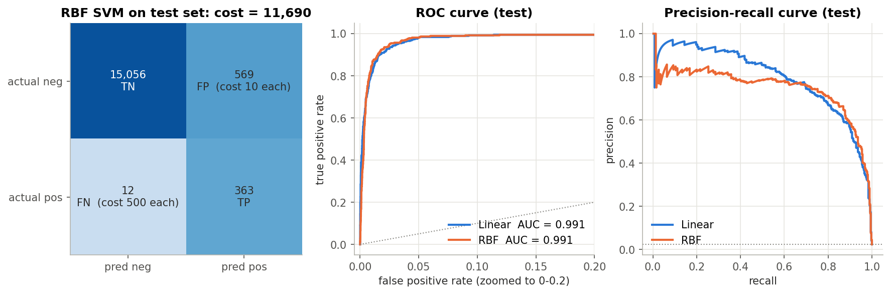
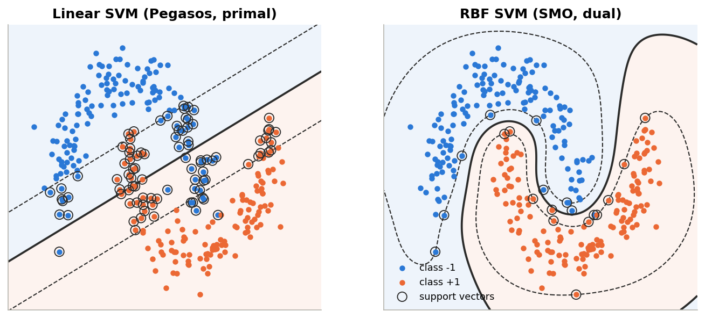
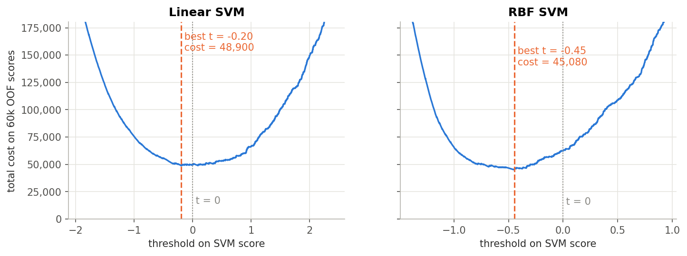

# APS Failure Prediction with Support Vector Machines 

**Dataset**  is taken from UCI Machine Learning Repository [Dataset](https://archive.ics.uci.edu/dataset/421/aps+failure+at+scania+trucks)

Predicting Air Pressure System (APS) failures in Scania heavy trucks using two Support Vector Machines that implemented by NumPy:

- a **linear SVM** trained in the primal with the **Pegasos** stochastic sub-gradient method
- a **kernel SVM with an RBF kernel** trained in the dual with **Sequential Minimal Optimisation (SMO)**

---

## Results at a glance

Scania scores a model by a cost function: a **false alarm costs 10** (an unnecessary workshop check), a **missed failure costs 500** (a possible breakdown on the road). Lower total cost is better.

| Model (test set, 16,000 trucks) | Total cost | False alarms | Missed failures | Recall | ROC AUC |
|---|---:|---:|---:|---:|---:|
| RBF SVM, SMO (selected by cross-validation) | **11,690** | 569 | 12 | 0.968 | 0.991 |
| Linear SVM, Pegasos | **10,980** | 798 | 6 | 0.984 | 0.991 |
| Baseline: predict "no failure" for every truck | 187,500 | 0 | 375 | 0.000 | – |


A couple of notes on these numbers:

- Hyperparameters and decision thresholds were chosen **only** with 5-fold cross-validation on the training set. The test set was scored once at the end.
- Cross-validation preferred the RBF model (CV cost 45,050 vs 48,900), but on the test set the linear model came out 710 lower. That gap is about 1.4 missed trucks, which is within the noise you'd expect from one test set with 375 failures. I kept the CV-selected model as "the" model rather than switching after seeing test results.



---

## Project structure

```
aps-failure-svm/
├── aps_failure_svm.ipynb   # the full analysis, executed with outputs
├── README.md                            # this file (results + SVM maths)
├── requirements.txt
├── data/
│   ├── aps_failure_training_set.csv     # 60,000 trucks (1,000 failures)
│   ├── aps_failure_test_set.csv         # 16,000 trucks (375 failures)
│   └── aps_failure_description.txt
├── figures/                             # every plot from the notebook
└── models/
    └── rbf_svm_aps.npz                  # final model: preprocessing params + support vectors + threshold
```

## How to run

```bash
pip install -r requirements.txt
jupyter notebook aps_failure_svm.ipynb
```

## What the notebook does

1. **Exploratory analysis**: 1:59 class imbalance, 8% missing cells, 160 of 170 features with |skewness| > 2, and failing trucks having about twice as many missing readings as healthy ones.
2. **Preprocessing**: drop 7 columns that are >70% missing plus 1 constant column, median imputation, `log1p`, standardisation. All of it is re-fitted inside every CV fold so nothing leaks from validation data.
3. **Two SVMs from scratch** (maths below).
4. **Sanity check on a 2D toy problem**: you can see the decision boundary, the margins and the support vectors, and check that the dual constraint $\sum_i \alpha_i y_i = 0$ holds.
5. **Stratified 5-fold CV** for $\lambda$ (linear) and $C$, $\gamma$, class weight (RBF).
6. **Cost-optimal threshold** picked on the out-of-fold scores of all 60,000 training trucks.
7. **Final test evaluation**, plus a check that the saved `.npz` model reproduces the same predictions with plain NumPy.



---

# The maths behind the models

## 1. Setting

We have $n$ training examples $(x_i, y_i)$ with feature vectors $x_i \in \mathbb{R}^d$ and labels $y_i \in \{-1, +1\}$. Here $+1$ means "APS failure" and $-1$ means "some other failure". An SVM learns a score function

$$f(x) = w^\top x + b$$

and predicts $+1$ when $f(x) \ge t$ for some threshold $t$ (normally $t = 0$).

The quantity $y_i f(x_i)$ is called the **functional margin** of point $i$. It's positive when the point is on the correct side, and the bigger it is, the more confidently correct.

## 2. Hard margin: maximise the gap

If the classes can be separated by a hyperplane, there are infinitely many such hyperplanes. The SVM picks the one with the biggest gap to the nearest point on either side.

The distance from a point $x_i$ to the hyperplane $w^\top x + b = 0$ is $|w^\top x_i + b| / \lVert w\rVert$. We're free to rescale $w$ and $b$, so fix the scale by demanding that the closest points satisfy $y_i(w^\top x_i + b) = 1$. Then the gap between the two classes, the **margin**, is

$$\text{margin} = \frac{2}{\lVert w\rVert}$$

Maximising $2/\lVert w\rVert$ is the same as minimising $\frac12\lVert w\rVert^2$, which gives the hard-margin SVM:

$$\min_{w,\,b}\;\; \frac12 \lVert w\rVert^2 \qquad \text{s.t.}\qquad y_i(w^\top x_i + b) \ge 1 \quad \forall i$$

## 3. Soft margin: allow some mistakes

Real data (this dataset included) isn't perfectly separable. So we give each point a **slack variable** $\xi_i \ge 0$ that measures how far it violates the margin, and pay for it:

$$\min_{w,\,b,\,\xi}\;\; \frac12 \lVert w\rVert^2 + C\sum_{i=1}^n \xi_i \qquad \text{s.t.}\qquad y_i(w^\top x_i + b) \ge 1 - \xi_i,\quad \xi_i \ge 0$$

- $\xi_i = 0$: the point is outside the margin, all good
- $0 < \xi_i \le 1$: inside the margin but still correctly classified
- $\xi_i > 1$: misclassified

$C$ controls the trade-off. A large $C$ punishes violations heavily (narrow margin, risk of overfitting). A small $C$ tolerates them (wide margin, smoother boundary).

### The hinge loss view

At the optimum each slack is as small as allowed, so $\xi_i = \max(0,\, 1 - y_i f(x_i))$. Substituting it back gives an unconstrained problem:

$$\min_{w,\,b}\;\; \frac{\lambda}{2}\lVert w\rVert^2 + \frac1n \sum_{i=1}^n \max\bigl(0,\; 1 - y_i(w^\top x_i + b)\bigr), \qquad \lambda = \frac{1}{nC}$$

The term $\max(0, 1 - y f)$ is the **hinge loss**. It's zero for points safely beyond the margin and grows linearly for points that aren't. This is the form the linear SVM optimises directly.

### Class weights

With 59 healthy trucks for every failure, the unweighted loss would happily sacrifice the failures. So each point gets a weight $c_i$:

$$\min_{w,\,b}\;\; \frac{\lambda}{2}\lVert w\rVert^2 + \frac1n \sum_{i=1}^n c_i \max\bigl(0,\; 1 - y_i(w^\top x_i + b)\bigr)$$

For the linear model I use "balanced" weights: $c_i = n_{-}/n_{+} = 59$ for failures, $1$ for the rest, then normalised so the average weight is 1. In the dual (kernel) version, the weight shows up as a separate upper bound $C_i$ per point, as we'll see.

---

## 4. Linear SVM: the Pegasos algorithm

The hinge loss has a kink at $y f = 1$, so it has no gradient there. It does have a **sub-gradient**, which is good enough for gradient descent. For a single point:

$$\partial_w \max(0,\, 1 - y_i f(x_i)) = \begin{cases} -y_i x_i & \text{if } y_i f(x_i) < 1 \\ 0 & \text{otherwise} \end{cases}$$

So only margin violators push the weights. For a mini-batch $B$ the full sub-gradient of the objective is

$$g_w = \lambda w - \frac{1}{|B|}\sum_{i \in B^{+}} c_i\, y_i\, x_i, \qquad g_b = -\frac{1}{|B|}\sum_{i \in B^{+}} c_i\, y_i, \qquad B^{+} = \{ i \in B : y_i f(x_i) < 1 \}$$

**Pegasos** (Shalev-Shwartz, Singer & Srebro, 2007) adds two ingredients to plain SGD:

1. **Step size** $\eta_t = \dfrac{1}{\lambda t}$. Because the objective is $\lambda$-strongly convex, this schedule gives an $O(1/(\lambda T))$ convergence rate and needs no tuning.
2. **Projection.** It can be shown that the optimal $w^*$ satisfies $\lVert w^*\rVert \le 1/\sqrt{\lambda}$. After every step, if $w$ has left that ball, it gets scaled back onto it:

$$w \leftarrow \min\!\left(1,\; \frac{1/\sqrt{\lambda}}{\lVert w\rVert}\right) w$$

The full loop I implemented:

```
w = 0, b = 0, t = t0
for epoch in 1..E:
    shuffle the data
    for each mini-batch B:
        eta  = 1 / (lambda * t)
        V    = { i in B : y_i (w·x_i + b) < 1 }           # margin violators
        w   <- w - eta * ( lambda*w - (1/|B|) * sum_{i in V} c_i y_i x_i )
        b   <- b + eta * (1/|B|) * sum_{i in V} c_i y_i
        w   <- project w onto the ball of radius 1/sqrt(lambda)
        if epoch is in the second half: update running average of (w, b)
        t   <- t + 1
return the averaged (w, b)
```

Two small practical changes from the textbook version:

- **`t0 = 1000`** instead of starting at $t = 1$. With a small $\lambda$, the first step $\eta_1 = 1/\lambda$ would be enormous and throw $w$ far away.
- **Iterate averaging.** Stochastic sub-gradient steps keep jumping around the optimum. Averaging the iterates of the second half of training cancels most of that noise. The convergence plot in the notebook shows this nicely: the per-epoch objective jumps around early on, while the averaged weights land at (or below) the best single epoch.

Cost per epoch is $O(nd)$, which is why the linear SVM trains on all 60,000 trucks in about 2 seconds.

---

## 5. The dual problem

To use kernels we need to look at the problem from the other side. Start from the soft-margin primal with per-point penalties $C_i$ (that's where class weights go), and attach Lagrange multipliers $\alpha_i \ge 0$ to the margin constraints and $\mu_i \ge 0$ to $\xi_i \ge 0$:

$$\mathcal{L}(w, b, \xi, \alpha, \mu) = \frac12\lVert w\rVert^2 + \sum_i C_i \xi_i - \sum_i \alpha_i\bigl[y_i(w^\top x_i + b) - 1 + \xi_i\bigr] - \sum_i \mu_i \xi_i$$

Setting the derivatives with respect to the primal variables to zero:

$$\frac{\partial \mathcal{L}}{\partial w} = 0 \;\Rightarrow\; w = \sum_i \alpha_i y_i x_i$$

$$\frac{\partial \mathcal{L}}{\partial b} = 0 \;\Rightarrow\; \sum_i \alpha_i y_i = 0$$

$$\frac{\partial \mathcal{L}}{\partial \xi_i} = 0 \;\Rightarrow\; C_i - \alpha_i - \mu_i = 0 \;\Rightarrow\; 0 \le \alpha_i \le C_i$$

The first line is the key result: **the weight vector is a weighted sum of training points.** Plugging these back into $\mathcal{L}$ removes $w$, $b$ and $\xi$ completely and leaves the **dual problem**:

$$\max_{\alpha}\;\; \sum_i \alpha_i - \frac12 \sum_i\sum_j \alpha_i \alpha_j\, y_i y_j\, x_i^\top x_j \qquad \text{s.t.}\qquad 0 \le \alpha_i \le C_i, \quad \sum_i \alpha_i y_i = 0$$

### KKT conditions and support vectors

At the optimum, complementary slackness tells us what each $\alpha_i$ means:

| $\alpha_i$ | Condition | What the point is |
|---|---|---|
| $\alpha_i = 0$ | $y_i f(x_i) \ge 1$ | correctly classified, outside the margin, plays no role at all |
| $0 < \alpha_i < C_i$ | $y_i f(x_i) = 1$ | **free support vector**, sits exactly on the margin |
| $\alpha_i = C_i$ | $y_i f(x_i) \le 1$ | **bounded support vector**, inside the margin or misclassified |

Only points with $\alpha_i > 0$ (the **support vectors**) contribute to $w$. In this project the final RBF model is defined by 1,781 of its 16,000 training trucks.

**The bias** comes from the free support vectors: since they satisfy $y_k f(x_k) = 1$ exactly,

$$b = y_k - \sum_i \alpha_i y_i\, x_i^\top x_k$$

for any free $k$. In practice I average this over all free support vectors for numerical stability.

---

## 6. The kernel trick

Look at the dual again: the data only shows up as inner products $x_i^\top x_j$. And the score function becomes

$$f(x) = \sum_i \alpha_i y_i\, x_i^\top x + b$$

which also only needs inner products. So if we map every point into some richer feature space $\phi(x)$, we never need $\phi$ itself, only $K(x, z) = \phi(x)^\top\phi(z)$. That's the **kernel trick**. The dual becomes

$$\max_{\alpha}\;\; \sum_i \alpha_i - \frac12 \sum_{i,j} \alpha_i \alpha_j\, y_i y_j\, K(x_i, x_j) \qquad \text{s.t.}\qquad 0 \le \alpha_i \le C_i,\quad \sum_i \alpha_i y_i = 0$$

and predictions are

$$f(x) = \sum_{i \in SV} \alpha_i y_i\, K(x_i, x) + b$$

I use the **RBF (Gaussian) kernel**:

$$K(x, z) = \exp\bigl(-\gamma \lVert x - z\rVert^2\bigr)$$

It corresponds to an infinite-dimensional feature space. Each support vector puts a Gaussian bump of width $\sim 1/\sqrt{\gamma}$ around itself, and the decision boundary is where the weighted bumps of the two classes balance out. Small $\gamma$ gives wide bumps and a smooth boundary. Large $\gamma$ gives narrow bumps and a wiggly one.

To compute the kernel matrix efficiently I use $\lVert x - z\rVert^2 = \lVert x\rVert^2 + \lVert z\rVert^2 - 2x^\top z$, so the whole matrix comes from a single matrix multiplication, built in place in float32 to save memory.

**Class weights in the dual:** failures get $C_{+} = C \cdot w_{+}$ and healthy trucks get $C_{-} = C$. Failures are allowed to have bigger $\alpha$ values, so they pull harder on the boundary.

---

## 7. Solving the dual: Sequential Minimal Optimisation (SMO)

The dual is a quadratic program with $n$ variables. General QP solvers need the whole $n \times n$ matrix and scale badly. SMO (Platt, 1998) takes a much simpler route: **optimise two multipliers at a time, analytically, and repeat.**

Why two? Because of $\sum_i \alpha_i y_i = 0$. If you change a single $\alpha_i$, the constraint breaks. With two, you can move them together along a line that keeps the sum fixed.

My implementation follows the version inside LIBSVM (Fan, Chen & Lin, 2005). It's cleaner to write the dual as a minimisation:

$$\min_\alpha\;\; F(\alpha) = \frac12 \alpha^\top Q \alpha - \mathbf{1}^\top\alpha, \qquad Q_{ij} = y_i y_j K(x_i, x_j)$$

with gradient

$$G = \nabla F(\alpha) = Q\alpha - \mathbf{1}$$

At the start $\alpha = 0$, so $G = -\mathbf{1}$.

### 7.1 When are we done? (optimality condition)

Define the index sets of multipliers that are still allowed to move "up" or "down" along a feasible direction:

$$I_{up}(\alpha) = \{ t : \alpha_t < C_t,\ y_t = +1 \ \text{ or } \ \alpha_t > 0,\ y_t = -1 \}$$

$$I_{low}(\alpha) = \{ t : \alpha_t < C_t,\ y_t = -1 \ \text{ or } \ \alpha_t > 0,\ y_t = +1 \}$$

and

$$m(\alpha) = \max_{t \in I_{up}} -y_t G_t, \qquad M(\alpha) = \min_{t \in I_{low}} -y_t G_t$$

The KKT conditions hold exactly when $m(\alpha) \le M(\alpha)$. In code I stop when

$$m(\alpha) - M(\alpha) < \varepsilon \qquad (\varepsilon = 10^{-3},\ \text{same default as LIBSVM})$$

For intuition: $-y_t G_t$ is (up to the constant $b$) the negative of the prediction error $E_t = f(x_t) - y_t$. So $m - M$ is the largest disagreement between two points about where the boundary should be.

### 7.2 Which pair to update? (working set selection)

- **First index**, the most violating one:
$$i = \arg\max_{t \in I_{up}} -y_t G_t$$

- **Second index**, chosen with second-order information, i.e. the partner that gives the biggest decrease of the objective:
$$j = \arg\min_{t \in I_{low},\ -y_t G_t < -y_i G_i}\; -\frac{b_{it}^2}{a_{it}}$$
with
$$a_{it} = K_{ii} + K_{tt} - 2K_{it}, \qquad b_{it} = -y_i G_i + y_t G_t > 0$$

$a_{it}$ is the curvature of the objective along the pair's direction, and $b_{it}$ is how much they disagree. $b^2/a$ is exactly how much a Newton step along that line would reduce $F$. This "WSS3" rule converges in far fewer iterations than Platt's original heuristics.

### 7.3 Solving the two-variable problem

With everything except $\alpha_i, \alpha_j$ fixed, the constraint $y_i\alpha_i + y_j\alpha_j = \text{const}$ leaves one degree of freedom, so it's a 1-D quadratic with a closed-form minimum. In the classic Platt notation, with errors $E_k = f(x_k) - y_k$ and curvature $\eta = K_{ii} + K_{jj} - 2K_{ij}$:

$$\alpha_j^{new} = \alpha_j + \frac{y_j (E_i - E_j)}{\eta}$$

Then **clip** to the feasible segment $[L, H]$, which comes from intersecting the line with the box $[0, C_i] \times [0, C_j]$:

$$\text{if } y_i \ne y_j: \quad L = \max(0,\ \alpha_j - \alpha_i), \qquad H = \min(C_j,\ C_i + \alpha_j - \alpha_i)$$

$$\text{if } y_i = y_j: \quad L = \max(0,\ \alpha_i + \alpha_j - C_i), \qquad H = \min(C_j,\ \alpha_i + \alpha_j)$$

and finally move $\alpha_i$ by the opposite amount so that the equality constraint still holds:

$$\alpha_i^{new} = \alpha_i + y_i y_j\,(\alpha_j - \alpha_j^{new,clipped})$$

My code does exactly this, but in LIBSVM's gradient form (using $G$ instead of $E$, and handling the clipping for the two label cases separately). It's the same update, just written so that the bias is never needed inside the loop. Since the bounds are per-point $C_i, C_j$, the class weights fit in without any extra work.

### 7.4 Keeping the gradient up to date

After the update only two multipliers changed, so the gradient update needs just two kernel rows:

$$G \leftarrow G + Q_{:,i}\,\Delta\alpha_i + Q_{:,j}\,\Delta\alpha_j$$

Each iteration is therefore $O(n)$ given the kernel matrix. On the 16,000-truck training subset the final model needed about 4,000 iterations and roughly 5 seconds.

### 7.5 The bias

When SMO stops, every free support vector should satisfy $y_k f(x_k) = 1$. In terms of the gradient that gives

$$b = -\frac{1}{|F|}\sum_{k \in F} y_k G_k, \qquad F = \{k : 0 < \alpha_k < C_k\}$$

### 7.6 The full SMO loop

```
alpha = 0, G = -1
repeat:
    i = argmax over I_up  of  -y_t G_t                 # m(alpha)
    M = min over I_low of  -y_t G_t
    if m(alpha) - M < eps: stop                         # KKT satisfied
    j = argmin over valid t in I_low of  -b_it^2 / a_it  # second-order choice
    solve the 2-variable sub-problem for (alpha_i, alpha_j) and clip to the box
    G += Q[:, i] * d_alpha_i + Q[:, j] * d_alpha_j
b = mean of -y_k G_k over the free support vectors
keep only points with alpha > 0 as support vectors
```

### 7.7 The memory problem, and how I worked around it

The kernel matrix is $n \times n$. For all 60,000 trucks that's 3.6 billion entries (14 GB even in float32). So the kernel SVM is trained on **all 1,000 failures plus a random sample of healthy trucks** (12,000 per CV fold, 15,000 for the final model). Dropping negatives is much cheaper than dropping positives, and the decision threshold is tuned on the full, untouched validation data, so the shifted class ratio in training doesn't bias the final decisions.

---

## 8. From SVM score to decision: the cost-optimal threshold

An SVM gives a score, not a probability, and the default rule $f(x) \ge 0$ treats both kinds of error as equally bad. Here they aren't. If the model *were* calibrated, decision theory says predict "failure" whenever

$$P(\text{failure} \mid x) > \frac{\text{cost}_{FP}}{\text{cost}_{FP} + \text{cost}_{FN}} = \frac{10}{510} \approx 2\%$$

which is a very low bar. Since SVM scores aren't probabilities, I find the threshold empirically instead: sort the out-of-fold scores, compute

$$\text{cost}(t) = 10 \cdot FP(t) + 500 \cdot FN(t)$$

for every distinct threshold using cumulative sums ($O(n \log n)$ in total), and take the minimum. Both models end up with thresholds below zero: −0.20 for the linear SVM and −0.45 for the RBF SVM.



---

## 9. Evaluation metrics 

- **Confusion matrix**: TP, FP, FN, TN by direct counting
- **Precision** $= TP/(TP+FP)$, **Recall** $= TP/(TP+FN)$, **F1** $= 2PR/(P+R)$
- **ROC curve**: sort by score, cumulative TP and FP counts give TPR and FPR at every threshold; **AUC** by the trapezoid rule
- **Precision-recall curve**: same idea with precision instead of FPR
- **Total cost**: $10 \cdot FP + 500 \cdot FN$, the metric everything is optimised for

---
